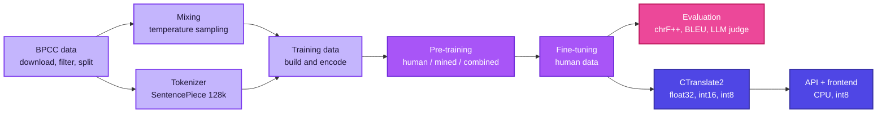

<div align="center">

<p align="center"></p>

**Compact multilingual machine translation for English and the 22 Scheduled Indian languages.**

[](LICENSE)
[](requirements-train.txt)
[](requirements-train.txt)
[](requirements-train.txt)
<br/>


[Results](#results) ·
[Languages](#supported-languages) ·
[How the pieces fit](#how-the-pieces-fit) ·
[User interface](#user-interface) ·
[Quick start](#quick-start) ·
[Links](#links) ·
[Citation](#citation)

</div>

---

## Overview

IndicMT is a **153.8M-parameter Transformer** (12 encoder + 12 decoder layers) that translates between English and 22
Indian languages, 44 directions in all. It is trained from scratch on AI4Bharat's BPCC data, with one 128k SentencePiece
vocabulary and a target-language tag at the start of each source sentence. It is converted to CTranslate2 and served on
**CPU with int8 weights (170.6 MB)** behind a FastAPI backend and a plain HTML/JS frontend. Translation between two Indian
languages goes through English.

This repository holds the whole pipeline: data preparation, mixing, tokenizer, training, fine-tuning, evaluation,
quantization and serving. It contains code, configs and documentation only. Data, models and results are generated by the
scripts and are not stored here.

## Results

Release model: 12+12 layers, pre-trained on the combined 8:2 (mined to human) data (step 13,600), then fine-tuned on
human data without replay (step 1,800). Macro average over the 22 languages, chrF++, OpenNMT-py (`onmt_translate`,
beam 5):

| Test set | en→xx | xx→en |
|---|---:|---:|
| IN22-Gen | **46.95** | **53.69** |
| IN22-Conv | **42.97** | **50.38** |

- **chrF++** is a character n-gram F-score. Higher is better. BLEU for the same model: IN22-Gen 19.11 (en→xx) and
  29.00 (xx→en); IN22-Conv 15.80 and 28.29.
- **CPU inference** (CTranslate2, beam 5, IN22-Gen): float32 47.15 / 53.87 and int8 47.16 / 53.85. **int8 is not
  significantly different from float32** (paired bootstrap, pooled p = 0.18 en→xx and 0.15 xx→en; 0 of 22 directions
  after Bonferroni correction), and it is 3.7 times smaller.
- Against 12 published systems on IN22-Gen, IndicMT ranks **3rd of 13 on en→xx**, 9th on xx→en and 5th of 13 on the
  two-direction mean, with far fewer parameters (0.154B, against 1.1B to 30.7B). The comparison is indicative: the
  baselines are model-card scores (sentence-level, greedy decoding), except IndicTrans2, which we re-ran with our
  protocol; ours and IndicTrans2's are corpus-level with beam 5.
- **Against IndicTrans2 1B under the same protocol** (IN22-Gen, paired bootstrap): IndicMT is slightly but
  significantly ahead on en→xx when the 22 directions are pooled (47.11 against 46.53, p = 0.001), though per
  direction it is split (11 directions better, 10 worse at p < 0.05). IndicTrans2 is clearly ahead on xx→en (62.48
  against 53.69) and has 1.1B parameters, 7.2 times more than IndicMT.
- **LLM judge** (Gemma 4 31B-it, English to Indic): being re-run on the corrected translations. The earlier judge
  results used translations from the old source encoding and are withdrawn.

> [!NOTE]
> **Corrected scores (October 2026).** Earlier versions of this page reported scores computed with a source encoding
> that differed from training by one SentencePiece piece (a lone `▁` before the language tag). Training, evaluation
> and serving now share one encoding function ([`data/common/tokenization.py`](data/common/tokenization.py)). The fix
> raised en→xx by about 2 chrF++ on average and left xx→en nearly unchanged. Details:
> [`docs/evaluation.md`](docs/evaluation.md#2-source-encoding).

> [!WARNING]
> **Caveats.** The release model is a **single training run**. Two extra seeds of the human-only arm reproduce that
> arm's chrF++ curve (38.3, 38.3 and 38.5 en→xx on IN22-Gen at step 2,000), but the seed variance of the release model
> itself is not measured. Checkpoints were **selected using the IN22 test sets**, so the IN22 scores carry a small
> optimistic bias. Under the corrected scores, a few other checkpoints are up to 0.2 chrF++ higher on the mean of the
> four IN22 buckets (48.70 against 48.50; single seed, not significance-tested). The release model was kept. See
> [`docs/training.md`](docs/training.md).

### Results by language (release model)

chrF++ through OpenNMT-py (beam 5) on IN22-Gen and IN22-Conv. The fuller version, with the best published score per
language, is in [`docs/evaluation.md`](docs/evaluation.md).

<details>
<summary><b>Show the per-language table (22 languages)</b></summary>
<br/>

| Language | IN22-Gen en→xx | IN22-Gen xx→en | IN22-Conv en→xx | IN22-Conv xx→en |
|---|---:|---:|---:|---:|
| Assamese | 44.53 | 55.78 | 44.20 | 55.41 |
| Bengali | 47.18 | 54.23 | 44.68 | 53.41 |
| Bodo | 49.15 | 52.29 | 46.17 | 49.08 |
| Dogri | 55.55 | 60.83 | 50.46 | 57.88 |
| Gujarati | 50.77 | 57.84 | 50.09 | 56.40 |
| Hindi | 53.12 | 56.77 | 47.18 | 55.13 |
| Kannada | 48.96 | 55.17 | 31.70 | 43.00 |
| Kashmiri | 32.89 | 50.20 | 27.30 | 46.91 |
| Konkani | 43.40 | 49.60 | 41.24 | 45.23 |
| Maithili | 49.57 | 56.51 | 43.85 | 51.88 |
| Malayalam | 44.65 | 53.28 | 37.80 | 48.08 |
| Manipuri | 45.60 | 50.13 | 41.48 | 46.29 |
| Marathi | 48.47 | 54.77 | 45.74 | 52.68 |
| Nepali | 49.53 | 58.69 | 49.54 | 57.01 |
| Odia | 46.05 | 56.99 | 40.73 | 54.33 |
| Punjabi | 47.11 | 53.66 | 52.44 | 56.02 |
| Sanskrit | 36.82 | 45.59 | 34.23 | 41.76 |
| Santali | 40.65 | 43.43 | 42.67 | 44.90 |
| Sindhi | 39.47 | 50.26 | 37.03 | 45.81 |
| Tamil | 47.43 | 50.23 | 37.91 | 41.65 |
| Telugu | 49.42 | 53.87 | 42.64 | 47.24 |
| Urdu | 62.61 | 60.99 | 56.33 | 58.29 |
| **Average (macro)** | **46.95** | **53.69** | **42.97** | **50.38** |

</details>

## Supported languages

English and the 22 Scheduled Indian languages, with the BPCC code and script used for each (from
[`data/common/languages.py`](data/common/languages.py)). Every language is translated to and from English; translation
between two Indian languages goes through English.

| Language | Code | Script | | Language | Code | Script |
|---|---|---|---|---|---|---|
| English | `eng_Latn` | Latin | | Maithili | `mai_Deva` | Devanagari |
| Assamese | `asm_Beng` | Bengali | | Malayalam | `mal_Mlym` | Malayalam |
| Bengali | `ben_Beng` | Bengali | | Manipuri | `mni_Mtei` | Meitei (Meetei Mayek) |
| Bodo | `brx_Deva` | Devanagari | | Marathi | `mar_Deva` | Devanagari |
| Dogri | `doi_Deva` | Devanagari | | Nepali | `npi_Deva` | Devanagari |
| Gujarati | `guj_Gujr` | Gujarati | | Odia | `ory_Orya` | Odia |
| Hindi | `hin_Deva` | Devanagari | | Punjabi | `pan_Guru` | Gurmukhi |
| Kannada | `kan_Knda` | Kannada | | Sanskrit | `san_Deva` | Devanagari |
| Kashmiri | `kas_Arab` | Perso-Arabic | | Santali | `sat_Olck` | Ol Chiki |
| Konkani | `gom_Deva` | Devanagari | | Sindhi | `snd_Deva` | Devanagari |
| | | | | Tamil | `tam_Taml` | Tamil |
| | | | | Telugu | `tel_Telu` | Telugu |
| | | | | Urdu | `urd_Arab` | Perso-Arabic |

## How the pieces fit



Colours: lavender for data preparation, purple for training, pink for evaluation, indigo for conversion and serving.
Plain text: data → mixing → tokenizer → training data → pre-training → fine-tuning → evaluation, and fine-tuning →
CTranslate2 conversion and quantization → API and frontend.

| Directory | What it does | Details |
|---|---|---|
| [`data/`](data/README.md) | Downloads BPCC and IN22, filters, splits and tags the data | [`docs/data.md`](docs/data.md) |
| [`mixing/`](mixing/README.md) | Temperature-sampled mixtures (alpha 0.5, 3x cap, word-weighted) | [`docs/mixing.md`](docs/mixing.md) |
| [`tokenizer/`](tokenizer/README.md) | Trains SentencePiece models; picks 128k by fertility ([`analysis/`](tokenizer/analysis/README.md)) | [`docs/tokenizer.md`](docs/tokenizer.md) |
| [`training/`](training/README.md) | Builds training files; pre-training arms, fine-tuning, architecture study (all configs) | [`docs/training.md`](docs/training.md) |
| [`evaluation/`](evaluation/README.md) | chrF++ and BLEU harness, baselines, quantization significance, translation packaging | [`docs/evaluation.md`](docs/evaluation.md) |
| [`evaluation/llm_judge/`](evaluation/llm_judge/README.md) | LLM-as-judge scoring | [`docs/evaluation.md`](docs/evaluation.md) |
| [`deployment/`](deployment/README.md) | CTranslate2 conversion, quantization, FastAPI backend, frontend, Docker | [`docs/deployment.md`](docs/deployment.md) |
| [`scripts/`](scripts/README.md) | SLURM job templates (Job1 to Job23) | |
| [`docs/`](docs/README.md) | Plain-language write-ups | |

## User interface

The repository includes a simple web interface for translating text in the browser, served by the same FastAPI backend.
Below are screenshots of the interface and example translations.

> [!NOTE]
> The screenshots show the release model, served as int8 on CPU.

<table>
  <tr>
    <td colspan="2" align="center">
      <br/>
      <sub><b>Interface overview</b></sub>
    </td>
  </tr>
  <tr>
    <td align="center" width="50%">
      <br/>
      <sub><b>English → Hindi</b></sub>
    </td>
    <td align="center" width="50%">
      <br/>
      <sub><b>Hindi → English</b></sub>
    </td>
  </tr>
  <tr>
    <td align="center" width="50%">
      <br/>
      <sub><b>English → Tamil</b></sub>
    </td>
    <td align="center" width="50%">
      <br/>
      <sub><b>English → Bengali</b></sub>
    </td>
  </tr>
  <tr>
    <td align="center" width="50%">
      <br/>
      <sub><b>Hindi → Marathi</b> (pivoted through English)</sub>
    </td>
    <td align="center" width="50%">
      <br/>
      <sub><b>Benchmarks tab</b></sub>
    </td>
  </tr>
</table>

## Quick start

### Train from scratch

```bash
# 1. Install the full environment (torch must match your CUDA build; see the comment in requirements-train.txt)
pip install -r requirements-train.txt

# 2. Data (BPCC and IN22 are gated: request access on Hugging Face first)
export HF_TOKEN=<your token>
python data/bpcc-human/download_bpcc_human.py
python data/bpcc-mined/download_bpcc_mined.py
python data/in22/download_in22.py
python data/bpcc-human/create_splits.py

# 3. Each later stage runs locally or as a batch job from scripts/slurm/
mkdir -p logs
sbatch -p <partition> scripts/slurm/data_human_multilingual_dataset.sh      # Job1; see scripts/README.md for Job2 onwards
```

> [!IMPORTANT]
> BPCC and IN22 are gated datasets: request access on Hugging Face before running the download scripts.

Follow the READMEs in order: `data/`, `mixing/`, `tokenizer/`, `training/`, `evaluation/`, `deployment/`.

> [!TIP]
> Training the full set of models takes days on 4 A100 GPUs, so most readers will want the released weights instead.

### Translate with the released model

Weights at `<WEIGHTS_URL>`.

```bash
# minimal CPU environment: no PyTorch or OpenNMT-py needed
pip install -r requirements-deploy.txt
# stage the int8 CTranslate2 model and tokenizer as described in deployment/README.md, then:
uvicorn deployment.api.main:app --port 8000
curl -X POST localhost:8000/api/translate -H "Content-Type: application/json" \
  -d '{"text":"Hello, how are you?","source_lang":"en","target_lang":"hi"}'
```

Open `http://localhost:8000/` for the web interface.

## Links

| Resource | Link |
|---|---|
| Technical report | `<REPORT_URL>` |
| Blog post | `<BLOG_URL>` |
| Model weights | `<WEIGHTS_URL>` |
| IN22 translations of the release model | `<TRANSLATIONS_URL>` |

## Citation

If you use IndicMT, please cite the technical report:

```bibtex
@techreport{sharma2026indicmt,
  author = {Sharma, Ujjwal},
  title  = {{IndicMT}: Compact Multilingual Machine Translation for 22 Indian Languages},
  year   = {2026},
  note   = {Technical report}
}
```

## License

Apache License 2.0. See [`LICENSE`](LICENSE). Copyright 2026 Ujjwal Sharma. The training data (BPCC) and test sets (IN22) are
AI4Bharat's and have their own terms.
