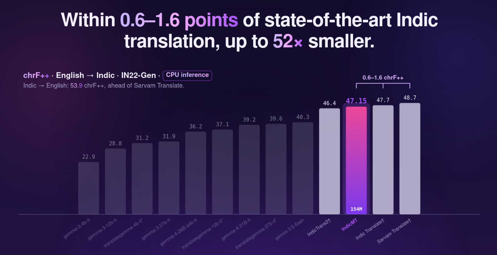
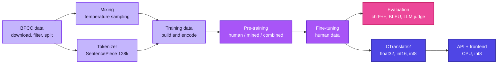
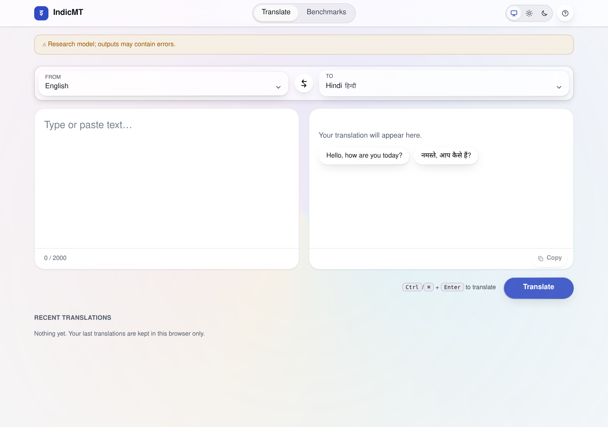
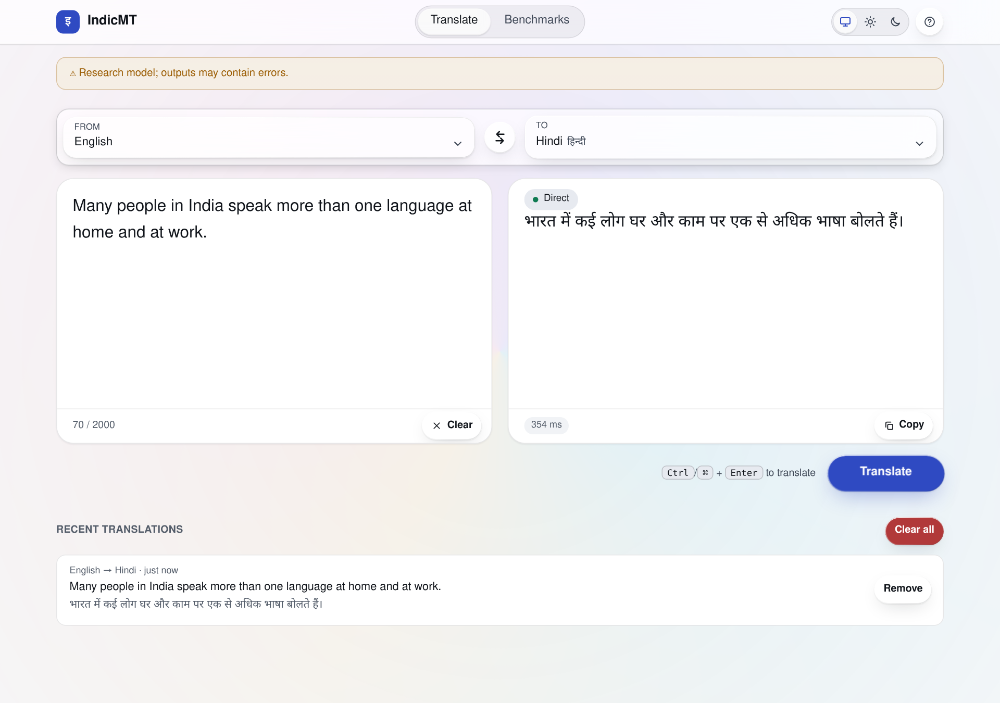
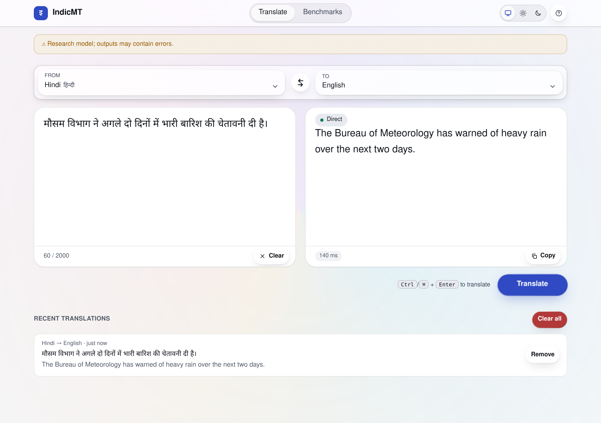
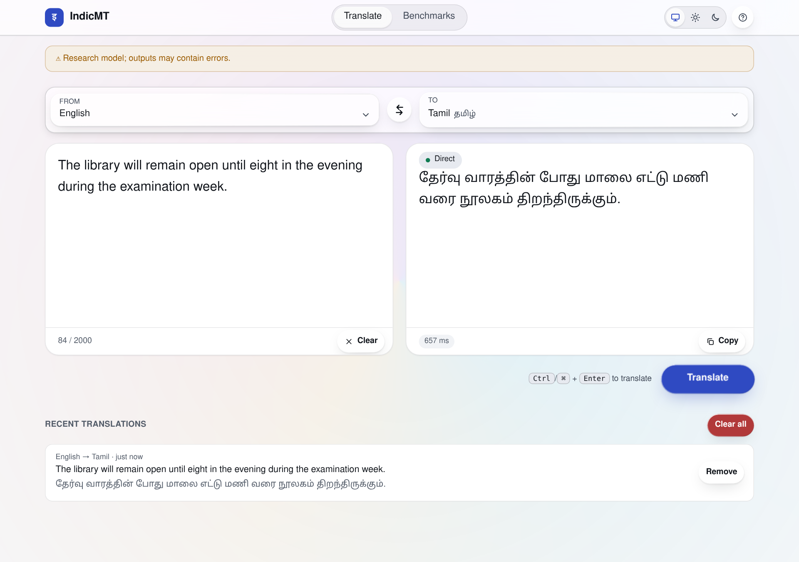
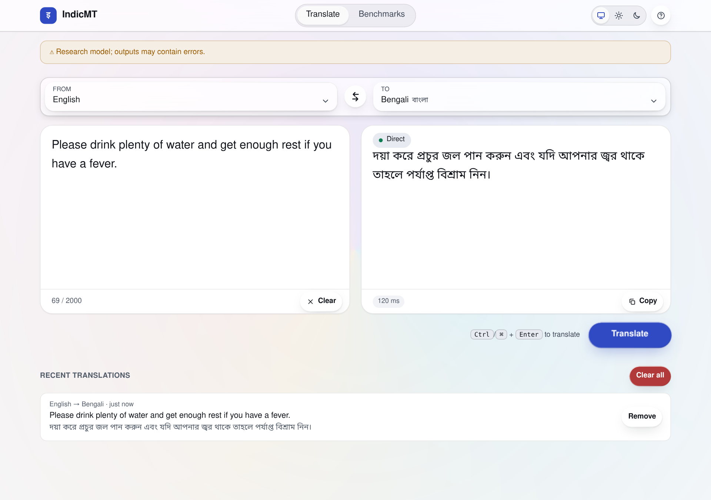
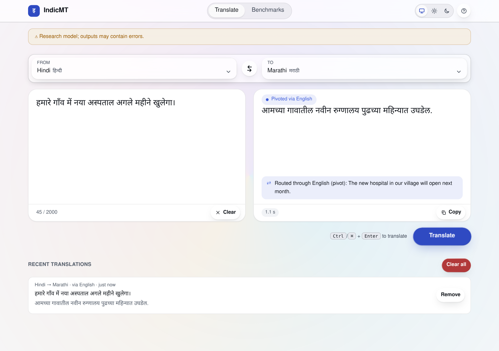
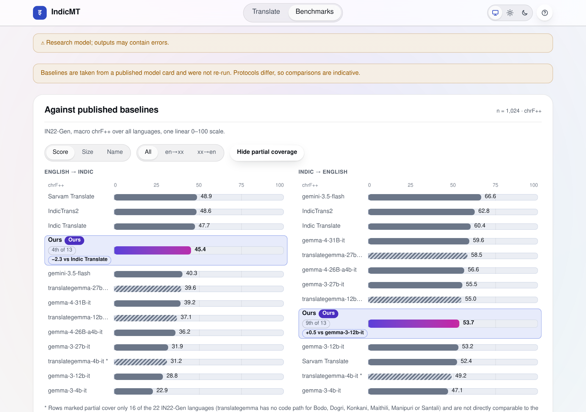

<div align="center">

<p align="center"></p>

**Compact multilingual machine translation for English and the 22 Scheduled Indian languages.**

[](LICENSE)
[](requirements-train.txt)
[](requirements-train.txt)
[](requirements-train.txt)
[](https://huggingface.co/ujjwalsharmaIITB/indicMT)
[](MEDIUM_BLOG_URL)
[](TECHNICAL_REPORT_URL)
<br/>


[Results](#results) ·
[Languages](#supported-languages) ·
[How the pieces fit](#how-the-pieces-fit) ·
[User interface](#user-interface) ·
[Quick start](#quick-start) ·
[Links](#links) ·
[Citation](#citation)

</div>

---

## Overview

IndicMT is a **153.8M-parameter Transformer** (12 encoder + 12 decoder layers) that translates between English and 22
Indian languages, 44 directions in all. It is trained from scratch on AI4Bharat's BPCC data, with one 128k SentencePiece
vocabulary and a target-language tag at the start of each source sentence. It is converted to CTranslate2 and served on
**CPU with int8 weights (170.6 MB)** behind a FastAPI backend and a plain HTML/JS frontend. Translation between two Indian
languages goes through English.

This repository holds the whole pipeline: data preparation, mixing, tokenizer, training, fine-tuning, evaluation,
quantization and serving. It contains code, configs and documentation only. Data, models and results are generated by the
scripts and are not stored here.

## Results

<p align="center"></p>

Release model: 12+12 layers, pre-trained on the combined 8:2 (mined to human) data (step 13,600), then fine-tuned on
human data without replay (step 1,800). Macro average over the 22 languages, chrF++, **CTranslate2 float32 model**
(beam 5; see [Quantization and the reported model](#quantization-and-the-reported-model)):

| Test set | en→xx | xx→en |
|---|---:|---:|
| IN22-Gen | **47.15** | **53.87** |
| IN22-Conv | **43.15** | **50.59** |

- **chrF++** is a character n-gram F-score. Higher is better. BLEU for the same model: IN22-Gen 19.19 (en→xx) and
  29.19 (xx→en); IN22-Conv 15.73 and 28.36.
- **Against IndicTrans2 1B under the same protocol** (paired bootstrap, 22 directions pooled): IndicMT is slightly but
  significantly ahead on en→xx on IN22-Gen (47.31 against 46.53, p = 0.001; 11 directions better, 8 worse at
  p < 0.05) and on IN22-Conv (43.23 against 42.60, p = 0.001; 8 better, 13 worse). IndicTrans2 is clearly ahead on xx→en (62.48 against 53.87 on IN22-Gen,
  55.63 against 50.59 on IN22-Conv) and has 1.1B parameters, 7.2 times more than IndicMT.
- **LLM judge** (Gemma 4 31B-it, en→xx, IN22-Gen, 22,528 sentences): shown the human reference, the judge rates
  **63.8%** of IndicMT translations perfect (5/5/5 on fluency, adequacy and overall; mean overall 4.33 of 5), against
  70.3% (4.48) for IndicTrans2 1B. Without the reference: 66.9% (4.38) against 73.8% (4.52).

### Compared with other systems

chrF++, macro average over the 22 languages. **IndicMT (CTranslate2 float32), IndicTrans2, Indic Translate and Sarvam Translate are from
our own runs** (corpus-level chrF++; beam 5 for IndicMT and IndicTrans2, greedy decoding for the two LLMs). **All other baselines are taken from the
[`bodhan-ai/indic-translate`](https://huggingface.co/bodhan-ai/indic-translate) model page** (read on 2026-09-19),
which reports sentence-level chrF++ with greedy decoding on IN22-Gen only, so those rows are indicative. A star marks a
system that covers only 16 of the 22 languages.

| Model | Parameters | IN22-Gen en→xx | IN22-Gen xx→en | IN22-Conv en→xx | IN22-Conv xx→en | Source |
|---|---:|---:|---:|---:|---:|---|
| **IndicMT (release model)** | **0.154B** | **47.15** | **53.87** | **43.15** | **50.59** | our run |
| IndicTrans2 1B | 1.1B | 46.39 | 62.48 | 42.61 | 55.63 | our run |
| Indic Translate | 7.94B | 47.73 | 60.33 | 45.04 | 55.10 | our run |
| Sarvam Translate | 4B | 48.74 | 51.82 | 45.71 | 49.77 | our run |
| gemini-3.5-flash | undisclosed | 40.30 | 66.60 | | | Indic Translate page |
| gemma-4-31B-it | 30.7B | 39.20 | 59.60 | | | Indic Translate page |
| translategemma-27b-it * | 27B | 39.60 | 58.50 | | | Indic Translate page |
| gemma-4-26B-a4b-it | 25.2B | 36.20 | 56.60 | | | Indic Translate page |
| translategemma-12b-it * | 12B | 37.10 | 55.00 | | | Indic Translate page |
| gemma-3-27b-it | 27.43B | 31.90 | 55.50 | | | Indic Translate page |
| gemma-3-12b-it | 12.19B | 28.80 | 53.20 | | | Indic Translate page |
| translategemma-4b-it * | 4B | 31.20 | 49.20 | | | Indic Translate page |
| gemma-3-4b-it | 4.3B | 22.90 | 47.10 | | | Indic Translate page |

Under the same scoring, IndicMT is 0.58 chrF++ below Indic Translate and 1.59 below Sarvam Translate on IN22-Gen
en→xx (1.89 and 2.56 below on IN22-Conv), and ahead of Sarvam Translate on xx→en on both test sets. BLEU from our runs
(IN22-Gen en→xx / xx→en, IN22-Conv en→xx / xx→en): IndicMT 19.19 / 29.19, 15.73 / 28.36; IndicTrans2 17.88 / 39.12,
15.22 / 34.02; Indic Translate 19.37 / 36.43, 17.30 / 33.37; Sarvam Translate 20.67 / 28.32, 17.95 / 27.51.

Parameter counts come from each model's public page; see [`docs/evaluation.md`](docs/evaluation.md#5-against-published-systems-in22-gen-only).

### Quantization and the reported model

**All results on this page are from the CTranslate2 float32 model**, the release checkpoint (OpenNMT-py step 1,800)
converted to CTranslate2 without quantization. The Hugging Face repository ships the OpenNMT-py checkpoint and the int8
CTranslate2 model. chrF++, beam 5; latency is the median for one sentence on CPU (8 threads), IN22-Gen.

| Model | IN22-Gen en→xx | IN22-Gen xx→en | IN22-Conv en→xx | IN22-Conv xx→en | p50 latency | Size |
|---|---:|---:|---:|---:|---:|---:|
| OpenNMT-py checkpoint (`onmt_translate`) | 46.95 | 53.69 | 42.97 | 50.38 | | 2.4 GB |
| **CTranslate2 float32 (reported)** | **47.15** | **53.87** | **43.15** | **50.59** | 399.2 ms | 630.4 MB |
| CTranslate2 int16 | 47.15 | 53.86 | 43.15 | 50.59 | 367.1 ms | 323.2 MB |
| CTranslate2 int8 (released) | 47.16 | 53.85 | 43.14 | 50.59 | 374.2 ms | 170.6 MB |

The checkpoint and the CTranslate2 float32 model have the same weights; their scores differ by about 0.2 chrF++
because the two decoders differ. int16 and int8 are **not significantly different from float32** on IN22-Gen (paired
bootstrap, pooled p = 0.18 en→xx and 0.15 xx→en for int8; 0 of 22 directions after Bonferroni correction). int8 is
3.7 times smaller than float32. The checkpoint's size includes the optimizer state.

### Results by language (release model)

chrF++ of the CTranslate2 float32 model (beam 5) on IN22-Gen and IN22-Conv. The fuller version, with the best baseline score per
language, is in [`docs/evaluation.md`](docs/evaluation.md).

<details>
<summary><b>Show the per-language table (22 languages)</b></summary>
<br/>

| Language | IN22-Gen en→xx | IN22-Gen xx→en | IN22-Conv en→xx | IN22-Conv xx→en |
|---|---:|---:|---:|---:|
| Assamese | 44.74 | 56.02 | 44.58 | 55.39 |
| Bengali | 47.24 | 54.39 | 45.01 | 53.75 |
| Bodo | 49.30 | 52.34 | 46.39 | 49.18 |
| Dogri | 55.86 | 61.04 | 50.64 | 58.29 |
| Gujarati | 50.88 | 57.92 | 50.21 | 56.42 |
| Hindi | 53.19 | 56.99 | 47.14 | 55.34 |
| Kannada | 49.06 | 55.31 | 31.70 | 43.40 |
| Kashmiri | 32.99 | 50.47 | 27.55 | 47.18 |
| Konkani | 43.51 | 49.67 | 41.41 | 45.31 |
| Maithili | 49.69 | 56.72 | 44.08 | 51.92 |
| Malayalam | 44.83 | 53.35 | 38.19 | 48.49 |
| Manipuri | 46.26 | 50.29 | 41.64 | 46.54 |
| Marathi | 48.63 | 54.94 | 46.08 | 52.94 |
| Nepali | 49.68 | 59.00 | 49.60 | 57.08 |
| Odia | 46.23 | 57.14 | 40.87 | 54.57 |
| Punjabi | 47.12 | 53.73 | 52.55 | 56.25 |
| Sanskrit | 37.26 | 45.86 | 34.35 | 41.76 |
| Santali | 41.11 | 43.72 | 42.99 | 45.11 |
| Sindhi | 39.73 | 50.54 | 37.11 | 46.16 |
| Tamil | 47.63 | 50.60 | 38.19 | 41.90 |
| Telugu | 49.58 | 54.03 | 42.56 | 47.61 |
| Urdu | 62.73 | 61.04 | 56.44 | 58.34 |
| **Average (macro)** | **47.15** | **53.87** | **43.15** | **50.59** |

</details>

## Supported languages

English and the 22 Scheduled Indian languages, with the BPCC code and script used for each (from
[`data/common/languages.py`](data/common/languages.py)). Every language is translated to and from English; translation
between two Indian languages goes through English.

| Language | Code | Script | | Language | Code | Script |
|---|---|---|---|---|---|---|
| English | `eng_Latn` | Latin | | Maithili | `mai_Deva` | Devanagari |
| Assamese | `asm_Beng` | Bengali | | Malayalam | `mal_Mlym` | Malayalam |
| Bengali | `ben_Beng` | Bengali | | Manipuri | `mni_Mtei` | Meitei (Meetei Mayek) |
| Bodo | `brx_Deva` | Devanagari | | Marathi | `mar_Deva` | Devanagari |
| Dogri | `doi_Deva` | Devanagari | | Nepali | `npi_Deva` | Devanagari |
| Gujarati | `guj_Gujr` | Gujarati | | Odia | `ory_Orya` | Odia |
| Hindi | `hin_Deva` | Devanagari | | Punjabi | `pan_Guru` | Gurmukhi |
| Kannada | `kan_Knda` | Kannada | | Sanskrit | `san_Deva` | Devanagari |
| Kashmiri | `kas_Arab` | Perso-Arabic | | Santali | `sat_Olck` | Ol Chiki |
| Konkani | `gom_Deva` | Devanagari | | Sindhi | `snd_Deva` | Devanagari |
| | | | | Tamil | `tam_Taml` | Tamil |
| | | | | Telugu | `tel_Telu` | Telugu |
| | | | | Urdu | `urd_Arab` | Perso-Arabic |

## How the pieces fit



Colours: lavender for data preparation, purple for training, pink for evaluation, indigo for conversion and serving.
Plain text: data → mixing → tokenizer → training data → pre-training → fine-tuning → evaluation, and fine-tuning →
CTranslate2 conversion and quantization → API and frontend.

| Directory | What it does | Details |
|---|---|---|
| [`data/`](data/README.md) | Downloads BPCC and IN22, filters, splits and tags the data | [`docs/data.md`](docs/data.md) |
| [`mixing/`](mixing/README.md) | Temperature-sampled mixtures (alpha 0.5, 3x cap, word-weighted) | [`docs/mixing.md`](docs/mixing.md) |
| [`tokenizer/`](tokenizer/README.md) | Trains SentencePiece models; picks 128k by fertility ([`analysis/`](tokenizer/analysis/README.md)) | [`docs/tokenizer.md`](docs/tokenizer.md) |
| [`training/`](training/README.md) | Builds training files; pre-training arms, fine-tuning, architecture study (all configs) | [`docs/training.md`](docs/training.md) |
| [`evaluation/`](evaluation/README.md) | chrF++ and BLEU harness, baselines, quantization significance, translation packaging | [`docs/evaluation.md`](docs/evaluation.md) |
| [`evaluation/llm_judge/`](evaluation/llm_judge/README.md) | LLM-as-judge scoring | [`docs/evaluation.md`](docs/evaluation.md) |
| [`deployment/`](deployment/README.md) | CTranslate2 conversion, quantization, FastAPI backend, frontend, Docker | [`docs/deployment.md`](docs/deployment.md) |
| [`huggingface/`](huggingface/README.md) | Model card, manifest and staging script for the Hugging Face model repository (weights are not tracked) | |
| [`scripts/`](scripts/README.md) | SLURM job templates (Job1 to Job23) | |
| [`docs/`](docs/README.md) | Plain-language write-ups | |

## User interface

The repository includes a simple web interface for translating text in the browser, served by the same FastAPI backend.
Below are screenshots of the interface and example translations.

> [!NOTE]
> The screenshots show the release model, served as int8 on CPU.

<table>
  <tr>
    <td colspan="2" align="center">
      <br/>
      <sub><b>Interface overview</b></sub>
    </td>
  </tr>
  <tr>
    <td align="center" width="50%">
      <br/>
      <sub><b>English → Hindi</b></sub>
    </td>
    <td align="center" width="50%">
      <br/>
      <sub><b>Hindi → English</b></sub>
    </td>
  </tr>
  <tr>
    <td align="center" width="50%">
      <br/>
      <sub><b>English → Tamil</b></sub>
    </td>
    <td align="center" width="50%">
      <br/>
      <sub><b>English → Bengali</b></sub>
    </td>
  </tr>
  <tr>
    <td align="center" width="50%">
      <br/>
      <sub><b>Hindi → Marathi</b> (pivoted through English)</sub>
    </td>
    <td align="center" width="50%">
      <br/>
      <sub><b>Benchmarks tab</b></sub>
    </td>
  </tr>
</table>

## Quick start

### Train from scratch

```bash
# 1. Install the full environment (torch must match your CUDA build; see the comment in requirements-train.txt)
pip install -r requirements-train.txt

# 2. Data (BPCC and IN22 are gated: request access on Hugging Face first)
export HF_TOKEN=<your token>
python data/bpcc-human/download_bpcc_human.py
python data/bpcc-mined/download_bpcc_mined.py
python data/in22/download_in22.py
python data/bpcc-human/create_splits.py

# 3. Each later stage runs locally or as a batch job from scripts/slurm/
mkdir -p logs
sbatch -p <partition> scripts/slurm/data_human_multilingual_dataset.sh      # Job1; see scripts/README.md for Job2 onwards
```

> [!IMPORTANT]
> BPCC and IN22 are gated datasets: request access on Hugging Face before running the download scripts.

Follow the READMEs in order: `data/`, `mixing/`, `tokenizer/`, `training/`, `evaluation/`, `deployment/`.

> [!TIP]
> Training the release model takes about 110 A100 GPU-hours (see [Compute](#compute)), so most readers will want the released weights instead.

### Translate with the released model

Weights: [ujjwalsharmaIITB/indicMT](https://huggingface.co/ujjwalsharmaIITB/indicMT) on Hugging Face, with the OpenNMT-py checkpoint (`indicMT.pt`), the int8 CTranslate2 model (`indicMT/`) and the tokenizer (`indicMT.spm.model`). Its model card, with examples for both models that encode inputs exactly as in training, is kept here as [`huggingface/README.md`](huggingface/README.md).

```bash
# minimal CPU environment: no PyTorch or OpenNMT-py needed
pip install -r requirements-deploy.txt
# stage the int8 CTranslate2 model and tokenizer as described in deployment/README.md, then:
uvicorn deployment.api.main:app --port 8000
curl -X POST localhost:8000/api/translate -H "Content-Type: application/json" \
  -d '{"text":"Hello, how are you?","source_lang":"en","target_lang":"hi"}'
```

Open `http://localhost:8000/` for the web interface.

## Compute

GPU-hours are GPUs × wall-clock hours, from the cluster's job accounting. Training ran on 4 × A100 80 GB; evaluation and the LLM judge ran on A40 and L40 GPUs.

**Release model only.** What it takes to reproduce the released model:

| Stage | GPUs | GPU-hours |
|---|---|---:|
| Pre-training, combined data, to step 13,600 | 4 × A100 | 100 |
| Fine-tuning on human data, to step 1,800 | 4 × A100 | 11 |
| IN22-Gen and IN22-Conv evaluation of one checkpoint, 88 directions, OpenNMT-py | 2 × A40 | 0.5 |
| chrF++ trajectory: the same evaluation for 63 checkpoints (54 pre-training up to step 13,600, 9 fine-tuning up to step 1,800) | 2 × A40 | 32 |
| IN22-Gen and IN22-Conv evaluation, CTranslate2 float32 (reported scores) | CPU, 16 cores | 0 (about 1 hour) |
| LLM judge, English→Indic | 2 × A40 | 7.7 |
| **Total** (the trajectory includes the single checkpoint) | | **about 150** |

**Whole project.** Everything run for IndicMT, including models that were not released:

| Work | GPU-hours |
|---|---:|
| Pre-training (human, mined and combined data) | 1,539 |
| Deeper architectures (12+18 and 18+18 layers) | 715 |
| IN22 evaluation of checkpoints | 473 |
| Fine-tuning (with and without replay, deeper models) | 248 |
| LLM judge | 135 |
| Baseline runs (IndicTrans2, Indic Translate, Sarvam Translate) | 15 |
| Setup and tests | 4 |
| **Total** | **3,129** |

By GPU type: 2,507 A100, 479 A40, 143 L40.

## Links

| Resource | Link |
|---|---|
| Technical report | [Technical report](TECHNICAL_REPORT_URL) |
| Medium blog | [Medium blog](MEDIUM_BLOG_URL) |
| Model weights | [huggingface.co/ujjwalsharmaIITB/indicMT](https://huggingface.co/ujjwalsharmaIITB/indicMT) |
| IN22 translations of the release model | `<TRANSLATIONS_URL>` |

## Citation

If you use IndicMT, please cite the technical report:

```bibtex
@techreport{sharma2026indicmt,
  author = {Sharma, Ujjwal},
  title  = {{IndicMT}: Compact Multilingual Machine Translation for 22 Indian Languages},
  year   = {2026},
  note   = {Technical report}
}
```

## License

Apache License 2.0. See [`LICENSE`](LICENSE). Copyright 2026 Ujjwal Sharma. The training data (BPCC) and test sets (IN22) are
AI4Bharat's and have their own terms.
