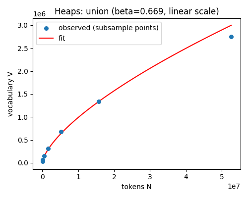
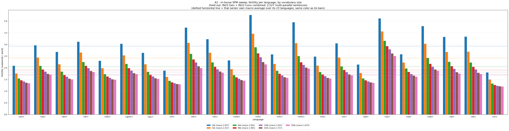
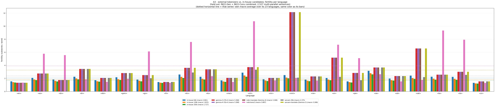

# Tokenizer

This page explains how the SentencePiece tokenizer is trained: which corpus it uses and why, the corpus-law
analysis, and how we chose a vocabulary size of 128k. Code: [`../tokenizer/`](../tokenizer/). The analysis scripts
are in [`../tokenizer/analysis/`](../tokenizer/analysis/).

Two terms first. A **subword** is a piece of a word. A tokenizer splits text into subwords so that rare words can be
built from common pieces. **Fertility** is the average number of subwords per word. Lower is better, because
sequences are shorter and the model learns each piece more reliably.

The model uses SentencePiece **unigram** (not BPE), one **joint** vocabulary for all 23 languages (shared by source
and target), `character_coverage=1.0` (with 8 or more scripts, dropping rare characters could gut a script) and the
23 language tags as reserved symbols.

## 1. What the tokenizer trains on

This is **not** the corpus the translation model trains on. The model uses the temperature-sampled mixtures
([`mixing.md`](mixing.md)). A tokenizer needs broad vocabulary *coverage* of each language, not the same balance of
training signal.

The rule, per language (`tokenizer/prepare_corpus.py`):

- **22 Indic languages:** take 100% of the language's bpcc-human data, then add script-filtered, deduplicated
  bpcc-mined data up to **1,000,000 sentences**. Gold data is never left out to make room for mined data.
- **English:** the same rule with a cap of **3,000,000** sentences.

### Why English also gets mined data

English's raw human data (about 3.43M rows) looks as if it already exceeds the 3M cap, but that figure is not
deduplicated. One human config, `ilci`, is
*multi-parallel*: the same English sentence is translated into many Indic languages, so it repeats in the raw count.
After deduplication there are only about **305,000** unique English sentences. English needs the same mined top-up
as every Indic language, and gets it (using reservoir sampling, so memory stays small).

The lesson: always deduplicate before counting. A raw row count and a unique-item count can differ by a factor of ten
on multi-parallel data, and only one of them is the right number to compare with a cap.

## 2. Corpus laws: Zipf and Heaps

Before training any model we measured two things for each of the 23 languages, on deduplicated target-side
bpcc-human text. Script: `tokenizer/analysis/scripts/corpus_laws.py`.

- **Zipf's law** describes how skewed word frequencies are. A few words are very common and a long tail is rare. Every
  language had a Zipf exponent between 0.90 and 1.38, a hapax rate (share of words seen once) above 48%, and a fit
  R-squared of at least 0.982. No word-level vocabulary of practical size can cover that tail. So subwords are
  justified outright.
- **Heaps' law** describes how fast the number of distinct word forms grows with corpus size. Extrapolated to 10 times
  the current corpus, the union of all 23 languages has about **14.0 million** word forms. Any subword vocabulary
  from 16k to 256k compresses that by about 55 times (256k) to 875 times (16k).

Vocabulary growth follows morphology:

| Typological group | Languages (Heaps beta) | Group mean |
|---|---|---:|
| Agglutinative (Tamil, Telugu, Kannada, Malayalam, Santali, Manipuri) | Malayalam 0.764, Kannada 0.718, Santali 0.714, Tamil 0.709, Manipuri 0.703, Telugu 0.689 | **0.716** |
| Fusional Indo-Aryan (the other 15 Indic languages) | 0.580 (Punjabi) to 0.683 (Nepali) | **0.646** |
| Isolating (English) | English 0.609 | 0.609 |
| Outlier | Sanskrit 0.797, the highest of all 23 | none |
| Union of all 23 | 0.669 | none |

Agglutinative languages (which stack suffixes) grow new word forms fastest. Sanskrit is a real outlier, probably
because of compounding and sandhi. This predicted that agglutinative languages and Sanskrit would have the worst
fertility under a shared vocabulary.

## 3. Choosing the vocabulary size: 128k

We trained seven SentencePiece models (16k to 256k), identical except for vocabulary size. We measured fertility per
language on **IN22-Gen and IN22-Conv combined** (2,527 sentences per language, the same content in all 23 languages).
This is a frozen property check on the test sets, not an optimization. No rule was fixed in advance. Fertility always
falls as the vocabulary grows, so "pick the lowest" would always pick the largest. We looked at the real curve.

| Vocabulary | Macro fertility | Worst case (language) | Embedding cost at d=512 |
|---|---:|---|---:|
| 16k | 2.927 | Malayalam 4.261 | 4% |
| 32k | 2.417 | Sanskrit 3.556 | 8% |
| 64k | 2.061 | Sanskrit 3.155 | 17% |
| 96k | 1.905 | Sanskrit 2.925 | 25% |
| **128k (chosen)** | **1.815** | Sanskrit 2.789 | **34%** |
| 192k | 1.717 | Sanskrit 2.611 | 50% |
| 256k | 1.675 | Sanskrit 2.506 | 67% |

"Macro" is the unweighted mean over the 23 languages. "Embedding cost" is the share of the roughly 200M parameter
budget used by the embedding table (`vocab_size x d_model`). Every vocabulary entry needs a row in that table, whether
or not it is used.

**Decision: 128k.** The gain from a bigger vocabulary shrinks (96k to 128k: 4.7%; 128k to 192k: 5.4%; 192k to 256k:
2.4%), while the embedding cost keeps rising. 128k already spends 34% of the budget on the table. 192k would spend
half of it.

One nuance is kept visible. **Sanskrit** is the worst language from 32k upward, and it keeps improving through 192k
after the average has flattened. That is a real gain, but it lands on one language while the cost lands on the whole
model. After training, Sanskrit is the second-weakest English-to-Indic direction (37.26 chrF++ on IN22-Gen), but it
trails the best of our three baseline runs by 0.82, well below the median gap of 2.00 across languages. So the evaluation does not
single out the vocabulary.

## 4. Comparison with external tokenizers

On the same held-out text, we compared our tokenizers with published ones.

| Tokenizer | Vocabulary | Macro fertility | Worst case | Note |
|---|---:|---:|---|---|
| In-house 128k (**chosen**) | 128k | **1.815** | Sanskrit 2.789 | |
| In-house 256k | 256k | 1.675 | Sanskrit 2.506 | |
| Sarvam-30B | about 68k | 2.375 | Sanskrit 3.668 | |
| IndicTrans2 (32k English + 128k Indic) | 160k total | 3.897 | Malayalam 10.745 | |
| Gemma 3 | 262,144 | 3.268 | Manipuri 12.137 | |
| Gemma 4 | 262,144 | 3.268 | Manipuri 12.137 | same vocabulary as Gemma 3 |
| Sarvam-Translate (Gemma 3 fine-tune) | 262,144 | 3.268 | Manipuri 12.137 | identical tokenizer file |
| Indic-Translate (Gemma 4 fine-tune) | 262,144 | 3.268 | Manipuri 12.137 | identical tokenizer file |

Our 128k tokenizer beats every external tokenizer compared, at less than half of IndicTrans2's macro fertility.

- **Gemma family:** a single-script penalty. All four have 12.14 fertility on Manipuri (Meitei Mayek script), about
  five times our worst case. A script that no other language shares gets almost no share of a general-purpose
  vocabulary, however large. This matches Petrov et al. (2023).
- **IndicTrans2:** nine languages above 5 (Malayalam 10.74, Tamil 9.32, Telugu 7.92, Kannada 7.57, Odia 7.16,
  Gujarati 6.13, Assamese 5.77, Bengali 5.56, Punjabi 5.10). The languages written in or near Devanagari all score
  under 2, except Sanskrit (2.63). Its Indic vocabulary is built mostly around Devanagari.
- **Identical tokenizers:** we checked by file hash that the Gemma 3 and Sarvam-Translate tokenizer files match, and
  likewise Gemma 4 and Indic-Translate. The table has only three independent tokenizers, not six.

Three comparability notes. Tokenizers do different jobs: Gemma's 262k vocabulary covers 140 or more languages and
code, ours covers 23, so low fertility bought with four times the table is not the same achievement. IndicTrans2
splits its vocabulary across two models, so we compare against its 160k total. And byte-fallback tokenizers never
produce `<unk>`, so a low unknown rate does not mean good coverage. Fertility stays meaningful across all of them.

The vocabulary size was chosen from these intrinsic measures. It was not validated by training translation models at
each candidate size.

## Files and outputs

| Step | Script | Writes (not tracked by git) |
|---|---|---|
| Build the training corpus | `tokenizer/prepare_corpus.py` (Job5) | `tokenizer/corpus/` |
| Train the 7 models | `tokenizer/train_spm.py` (Job6) | `tokenizer/sweep/mixed/spm_<size>.model` and `.vocab` |
| Corpus laws | `tokenizer/analysis/scripts/corpus_laws.py` (Job7) | `tokenizer/analysis/results/` |
| Fertility | `tokenizer/analysis/scripts/fertility.py` | `tokenizer/analysis/results/fertility.csv` |
| Plots | `tokenizer/analysis/scripts/plot_fertility.py` | `tokenizer/analysis/results/plots/` |

## Next step

Training data preparation and training: [`training.md`](training.md).
